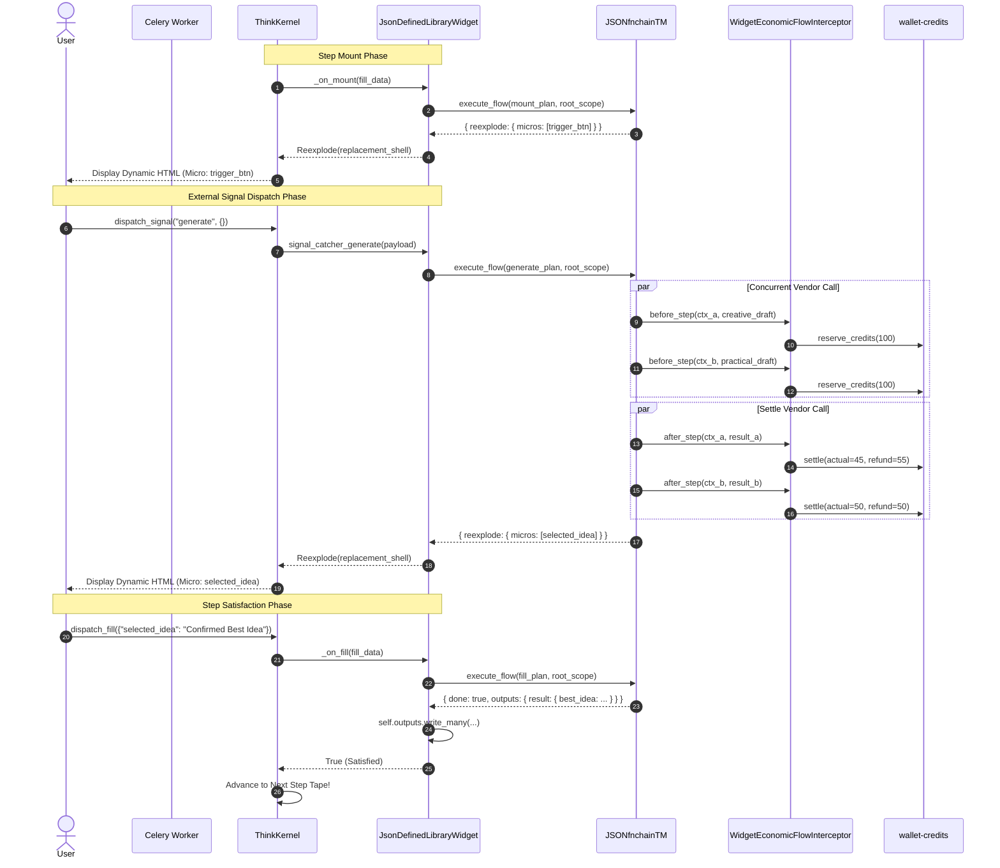

# MASTER PLAN: Pure JSON Declarative Widgets (Layer C) in Thinkument
## Consuming `JSONfnchainTM` & `bindings2bindingsTM` for Safe, Publishable, Dynamic-Lifecycle ThinkWidgets

## Phase 1 implementation status

Implemented and verified. See [the delivery sheet](thinkument/service-innovations/JSON_DEFINED_WIDGETS_DELIVERY.md) for concrete API decisions, registered-runner commands and exact results. Its commands supersede the direct pytest commands in section 7.2; its explicit vendor bindings supersede automatic simulated vendor mode in this blueprint.

> **Historical design record.** Sections below preserve the original proposal. Any
> snippets or interface descriptions using `build_widget_class_from_json`, the
> `transitions` manifest field, or automatic vendor behavior are obsolete examples,
> not supported current usage. The current API is `prepare_json_widget_v1`
> followed by explicit `register_prepared_json_widget_v1`; manifests use only
> top-level `signals`, and vendor routes are supplied by trusted Python bindings.

---

## 1. Executive Summary & Core Architectural Invariants

### 1.1 The Status Quo: Imperative Python Widget Authoring
In Thinkument today, authoring a ThinkWidget requires writing an imperative Python class inheriting from the cooperative MRO stack:
```python
class Seed(LibraryWidget):
    def _on_mount(self, position, fill_data, limits, stats):
        title = self.configuration.get('title', 'Draft')
        self.outputs.write_many({'result': ..., 'entries': ...})
        return Reexplode(
            next_fill_shell=self.replacement_shell(fill_data['fill_shell'], title=title, micros=[...]),
            pre_computed_fills={}
        )
    def _on_fill(self, signal, position, fill_data, limits, stats):
        self.outputs.keep_port('result')
        return True
```
While battle-tested for internal platform development, imperative Python presents two major architectural barriers for scaled application authoring and external web publishing:
1. **Security & Sandboxing:** Executing untrusted user-authored Python on backend worker servers risks sandbox escapes, memory/CPU exhaustion, and unsafe imports.
2. **Boilerplate & Maintenance:** Creating a new widget requires writing custom Python classes, registering decorators, handling shell replacement boilerplate, and maintaining bespoke test fixtures.

### 1.2 The Solution: Layer C (100% JSON-First Declarative Widgets)
By consuming the standalone [`JSONfnchainTM`](file:///Users/adarshjeewajee/Desktop/startups/independent-tooling/src/JSONfnchainTM) execution engine and [`bindings2bindingsTM`](file:///Users/adarshjeewajee/Desktop/startups/independent-tooling/src/bindings2bindingsTM) type/expression compiler, Thinkument introduces **Layer C: Pure JSON Declarative Widgets** (`c_service_ready_pureJSON_widget_declaration`), completing the 4-layer computation onion:

```
═════════════════════════════════════════════════════════════════════════════════════════════════════
                         THE 4-LAYER COMPUTATION ONION (Widget Formalism Depth)
═════════════════════════════════════════════════════════════════════════════════════════════════════
   Layer C: Pure JSON Declarative Widgets
            [thinkument/service-innovations/src/_funneled_apps/authoring_funnel/c_service_ready_pureJSON_widget_declaration]
            • 100% Declarative JSON manifest (Zero Python lifecycle code)
            • State transitions executed via JSONfnchainTM flows & bindings2bindingsTM
            • Interceptor hooks bridge step execution into Layer A economics & analytics
                                        ▲
                                        │ wraps
   Layer B: Typed P / SM / C / W Authoring
            [thinkument/service-innovations/src/_funneled_apps/authoring_funnel/b_service_ready_typed_PSMCW_authoring]
            • StrictServiceWidget: closed typed port contracts (PORT_INPUTS, PORT_OUTPUTS)
            • Inbound b2b wire binding evaluated into self.mouth; staged writes to self.outputs
            • Full P / SM / C / W compiler (compile_strict_program) registering strict_p_grammar_v1
                                        ▲
                                        │ wraps
   Layer A: Service-Tracked Widget Computation
            [thinkument/service-innovations/src/_funneled_apps/authoring_funnel/a_service_tracked_widget_computation]
            • ServiceReadyWidget combining Analytica audit spans + EconomicsWidgetMixin + Storagics
            • Automatic precharge credit holds, execution receipts, and audit-ins / audit-outs spans
                                        ▲
                                        │ wraps
   Layer 0: Raw Kernel Widget Substrate
            [thinkument/framework/think-backend]
            • DatumLifecycleWidget lifecycle: _on_mount, _on_fill, @signal_catcher, self._state
═════════════════════════════════════════════════════════════════════════════════════════════════════
```

### 1.3 Key Architectural Invariants of Layer C
1. **100% Declarative Manifest & Unified Signal Model:** Widget inputs, outputs, arguments, configuration, and all state transitions are authored in structured JSON (`kind: "json_widget_v1"`). All lifecycle explosions are represented by the canonical top-level `signals` mapping: `mount`, `fill`, and named signals.
2. **First-Class I/O Concurrency Inside Transitions:** A transition flow can fan out multiple vendor operations simultaneously via `"parallel": [ ... ]` or concurrent `"map": {"parallel": true, ...}` using local thread pools inside the Celery worker task.
3. **Dynamic Micros & Shell Replacement:** Micros are **dynamic per explosion**. Each transition computes its outcome: either **`Done`** (`done: true`), satisfying the widget step, or **`Reexplode`** (`reexplode: {...}`), dynamically refreshing `title`, `micros`, `pre_computed_fills`, and `micro_placement`.
4. **Standardized 5-Namespace Input Scope:** Every transition flow receives a verified initial root scope:
   `{"mouth": ..., "prior_outputs": ..., "signal": ..., "fills": ..., "config": ...}`.
5. **Thread-Safe Economics & Analytica Integration:** `WidgetEconomicFlowInterceptor` coordinates concurrent vendor calls: credit holds and audit spans are keyed by unique `ctx.attempt_id`, while widget event emission and analytics indexes (`next_index`) are serialized by an instance-level thread lock.
6. **Phase 1 Execution Scope:**
   - Pre-registers safe built-in transforms (`text.template`, `text.concat`, `math.add`, `data.extract`) alongside Vendor Hub AI operations (`vendor.llm.chat_completion`, `vendor.embeddings.generate`).
   - Proves end-to-end live session execution via preparation, explicit registration, and ordinary ThinkProgram compilation.
   - Outer web publishing database tables and raw REST upload endpoints are cleanly deferred to Phase 2.

---

## 2. Seamless Scaling Mechanics & Library Layering

Layer C does not create a bespoke domain-specific language or custom AST evaluator. It leverages the two battle-tested independent libraries—[`bindings2bindingsTM`](file:///Users/adarshjeewajee/Desktop/startups/independent-tooling/src/bindings2bindingsTM) and [`JSONfnchainTM`](file:///Users/adarshjeewajee/Desktop/startups/independent-tooling/src/JSONfnchainTM)—which already compose seamlessly:

```
┌──────────────────────────────────────────────────────────────────────────────────────────────┐
│                                 HOW THE 3 TIERS SCALE SEAMLESSLY                            │
├──────────────────────────────────────────────────────────────────────────────────────────────┤
│ 1. bindings2bindingsTM (Foundational Typing & Functional Expression Evaluator)               │
│    • Closed type universe: Str, Int, Float, Bool, Nullable, List, Dict, Map.                 │
│    • Expression engine (D.sugar): path traversal ($scope.field), conditionals ($cond),      │
│      arithmetic ($add, $sub), logic ($and, $or, $not), strings ($concat, $template),       │
│      collections ($in, $get, $slice, $len, $merge).                                          │
│    • Compile-time static proofs: zero Python evaluation at runtime, strict type safety.      │
│                                                ▲                                             │
│                                                │ compiles & types all expressions            │
│ 2. JSONfnchainTM (Declarative Step Flow & Concurrency Engine)                                │
│    • Control flow constructs: CallNode (vocab dispatch), ParallelNode (thread-pool fork-join)│
│      MapNode (array iteration with parallel workers), LoopNode (bounded fixed-point loops),  │
│      BranchNode (if-then-else conditions).                                                   │
│    • Scoped data passing: each step output populates the flow scope under its step ID.        │
│    • Vocabulary isolation: FunctionVocab snapshots verified contracts per execution.         │
│    • Observability hooks: FlowInterceptor lifecycle (before_step, after_step, on_step_error) │
│      with unique FlowAttemptContext (execution_id, attempt_id, node_path, host_context).     │
│                                                ▲                                             │
│                                                │ executes all widget transitions             │
│ 3. Layer C: c_service_ready_pureJSON_widget_declaration (Thinkument Widget Lifecycles)       │
│    • Manifest Compiler: Normalizes schema shorthands -> compiles flows via compile_flow.     │
│    • 5-Namespace Root Scope: Maps widget runtime state into {"mouth", "prior_outputs",       │
│      "signal", "fills", "config"} before passing to execute_flow.                            │
│    • Lifecycle Outcome Translation: Translates flow return dictionary to Thinkument          │
│      kernel primitives (Reexplode with dynamic micros, or satisfaction boolean True).        │
│    • Staged Port Commit: Maps return "outputs" and "keep" directives to StrictServiceWidget. │
│    • Economic Interceptor: Bridges JSONfnchainTM thread-pool calls into Layer A Economics     │
│      (precharge credit holds) and Analytica (monotonic audit spans).                         │
└──────────────────────────────────────────────────────────────────────────────────────────────┘
```

### 2.1 Why Scaling is Frictionless
- **Zero Impedance Mismatch in Data Representations:** `bindings2bindingsTM` schemas and expressions operate on pure JSON-serializable dictionaries and lists. `JSONfnchainTM` produces immutable JSON ASTs. Layer C consumes both directly without type casting or marshaling overhead.
- **Unified Expression Semantics:** Any expression valid in a wire binding in Layer B (`b_service_ready_typed_PSMCW_authoring`) is automatically valid in a transition step's `args`, loop predicate, map transform, or return outcome in Layer C.
- **Isolated Thread-Pool Concurrency:** `JSONfnchainTM`'s `execute_flow` manages bounded worker thread pools locally inside the Celery task without touching global event loops or asyncio machinery, matching Django and Celery worker thread models.
- **Fail-Closed Lifecycle Guarantees:** Because `JSONfnchainTM` guarantees that submitted tasks settle before an error escapes and calls `interceptor.on_step_error` on any failure, Layer C's `WidgetEconomicFlowInterceptor` releases all active credit holds and logs `audit-error` before `StrictServiceWidget._run_analytica_operation_v1` performs atomic state rollback.

---

## 3. Comprehensive Grammar & Feature Reference at Layer C

Layer C widgets have full access to the complete grammars and feature sets of both underlying libraries. To ensure that developers and subagents authoring widgets have a single source of truth without inspecting external packages, Layer C includes a dedicated in-tree guide:
[`thinkument/service-innovations/src/_funneled_apps/authoring_funnel/c_service_ready_pureJSON_widget_declaration/README_GRAMMAR_AND_FEATURES.md`](file:///Users/adarshjeewajee/Desktop/startups/thinkument/service-innovations/src/_funneled_apps/authoring_funnel/c_service_ready_pureJSON_widget_declaration).

The complete grammar specifications are documented below.

### 3.1 Type System & Port Schema Grammar (`bindings2bindingsTM`)

#### Primitive & Composite Types
| Type | Shorthand Syntax | Canonical Schema JSON | Description |
| :--- | :--- | :--- | :--- |
| **String** | `"str"` | `{"kind": "str"}` | UTF-8 string |
| **Integer** | `"int"` | `{"kind": "int"}` | Exact integer |
| **Float** | `"float"` | `{"kind": "float"}` | IEEE floating-point number |
| **Boolean** | `"bool"` | `{"kind": "bool"}` | `true` or `false` |
| **Nullable** | `"str?"` or `{"type": "nullable", "item": "str"}` | `{"kind": "nullable", "item": {"kind": "str"}}` | Value of type or `null` |
| **List** | `["str"]` or `{"type": "list", "item": "str"}` | `{"kind": "list", "item": {"kind": "str"}}` | Homogeneous ordered sequence |
| **Record** | `{"title": "str", "count": "int"}` | `{"kind": "dict", "fields": {"title": {"kind": "str"}, "count": {"kind": "int"}}}` | Closed dictionary with fixed fields |
| **Map** | `{"type": "map", "key": "str", "value": "int"}` | `{"kind": "map", "key": {"kind": "str"}, "value": {"kind": "int"}}` | Homogeneous key-value mapping |

#### Port Contract Invariants
- **Input Ports:** Can be any valid schema (Primitives, Nullable, List, Dict, or Map).
- **Output Ports:** Must normalize to closed **Record** schemas (`kind: "dict"`). Output ports cannot be naked primitives.

---

### 3.2 Expression Grammar (`bindings2bindingsTM` via `D.sugar`)

Expressions are used inside transition `args`, conditions, returns, and loop constructs.

#### Scope References & Literals
- **Path Reference:** `"$namespace.path.to.field"` resolves nested fields against visible scope.
- **Literal Value:** `{"$value": {"raw": "dict"}}` protects arbitrary literal data from variable substitution.
- **Implicit Literals:** Plain strings without leading `$`, numbers, and booleans evaluate to themselves.

#### Expression Operators Table
| Operator Family | JSON Syntax | Description | Example |
| :--- | :--- | :--- | :--- |
| **Equality** | `{"$eq": [expr_a, expr_b]}` | Value equality | `{"$eq": ["$mouth.status", "ready"]}` |
| | `{"$neq": [expr_a, expr_b]}` | Inequality | `{"$neq": ["$fills.choice", ""]}` |
| **Comparison** | `{"$lt": [a, b]}` | Less than | `{"$lt": ["$prior_outputs.count", 10]}` |
| | `{"$lte": [a, b]}` | Less than or equal | `{"$lte": ["$fills.rating", 5]}` |
| | `{"$gt": [a, b]}` | Greater than | `{"$gt": ["$config.budget", 100]}` |
| | `{"$gte": [a, b]}` | Greater than or equal | `{"$gte": ["$signal.level", 1]}` |
| **Boolean Logic**| `{"$and": [cond1, cond2, ...]}`| Logical conjunction | `{"$and": [{"$gt": ["$count", 0]}, "$is_active"]}` |
| | `{"$or": [cond1, cond2, ...]}` | Logical disjunction | `{"$or": ["$is_admin", "$is_moderator"]}` |
| | `{"$not": cond}` | Logical negation | `{"$not": "$mouth.is_locked"}` |
| **Conditionals** | `{"$cond": [test, then, else]}`| Inline ternary expression | `{"$cond": ["$is_pro", "Enterprise", "Standard"]}` |
| **Arithmetic** | `{"$add": [a, b]}` | Addition | `{"$add": ["$prior_outputs.revision", 1]}` |
| | `{"$sub": [a, b]}` | Subtraction | `{"$sub": ["$config.max_retries", "$attempts"]}` |
| | `{"$mul": [a, b]}` | Multiplication | `{"$mul": ["$quantity", "$unit_price"]}` |
| | `{"$div": [a, b]}` | Division | `{"$div": ["$total_cents", 100]}` |
| **Strings** | `{"$concat": [s1, s2, ...]}` | String concatenation | `{"$concat": ["Idea #", "$step_id.number"]}` |
| | `{"$lower": s}` | Lowercase conversion | `{"$lower": "$mouth.raw_text"}` |
| | `{"$upper": s}` | Uppercase conversion | `{"$upper": "$mouth.code"}` |
| | `{"$trim": s}` | Whitespace trimming | `{"$trim": "$fills.user_input"}` |
| **Collections** | `{"$in": [item, list]}` | Membership check | `{"$in": ["$signal.tag", "$config.allowed_tags"]}` |
| | `{"$get": [collection, key]}` | Dynamic indexing | `{"$get": ["$data_map", "$selected_key"]}` |
| | `{"$len": collection}` | Item count | `{"$len": "$mouth.items"}` |
| | `{"$slice": [list, start, end]}`| Subsequence | `{"$slice": ["$mouth.items", 0, 5]}` |
| | `{"$merge": [dict_a, dict_b]}` | Dictionary shallow union | `{"$merge": ["$prior_outputs.meta", "$new_meta"]}` |

---

### 3.3 Unified Signal Engine & Flow Control (`JSONfnchainTM`)

#### First Principles: All Transitions are Signals
In Thinkument's reactive kernel, a ThinkWidget is a state machine whose lifecycle explosions are driven exclusively by signals:
1. **`mount` (Initial Mount Signal):** Fired when the step activates and the widget first mounts.
2. **`fill` (Default Data-Fill Signal):** Fired when external users submit data to the widget's micro controls without a specific named signal.
3. **Named Signals (`generate`, `review`, `cancel`, etc.):** Fired when an external action targets the widget with a specific signal name.

Because every explosion undergoes the exact same execution lifecycle—taking the standardized 5-namespace root scope, executing flow steps, and returning either `done: true` or `reexplode: {...}` with dynamic micros and staged outputs—Layer C eliminates artificial nesting and unifies all transitions under a flat top-level `signals` dictionary:

```json
"signals": {
  "mount": { ... },
  "fill": { ... },
  "generate": { ... }
}
```

The removed `transitions` compatibility shape is not accepted; use `signals`.

A signal flow definition in Layer C contains:
```json
{
  "steps": [ ... ],
  "returns": { ... }
}
```
Or for instantaneous transitions without intermediate steps:
```json
{
  "done": true,
  "outputs": { ... }
}
```
Or instantaneous reexplosions:
```json
{
  "reexplode": {
    "title": "...",
    "micros": [ ... ]
  },
  "outputs": { ... }
}
```

#### Step Constructs
1. **Vocabulary Function Call (`CallNode`):**
   ```json
   {
     "id": "draft_text",
     "fn": "vendor.llm.chat_completion",
     "args": {
       "prompt": {"$concat": ["Analyze: ", "$mouth.context.brief"]}
     }
   }
   ```
   *Result:* Available in downstream scope as `$draft_text.text` and `$draft_text.usage`.

2. **Parallel Bounded Fork-Join (`ParallelNode`):**
   ```json
   {
     "id": "parallel_drafts",
     "parallel": [
       {
         "id": "creative_option",
         "fn": "vendor.llm.chat_completion",
         "args": {"prompt": "Write a wild creative headline"}
       },
       {
         "id": "conservative_option",
         "fn": "vendor.llm.chat_completion",
         "args": {"prompt": "Write a conservative corporate headline"}
       }
     ]
   }
   ```
   *Result:* Downstream scope has a dictionary `$parallel_drafts` with keys `creative_option` and `conservative_option`.

3. **Collection Mapping (`MapNode`):**
   ```json
   {
     "id": "vector_embeddings",
     "map": {
       "over": "$mouth.context.sentences",
       "as": "sentence",
       "parallel": true,
       "max_concurrency": 4,
       "steps": [
         {
           "id": "embed",
           "fn": "vendor.embeddings.generate",
           "args": {"text": "$sentence"}
         }
       ],
       "returns": "$embed.vector"
     }
   }
   ```
   *Result:* Downstream scope has a list `$vector_embeddings` of embedding vectors.

4. **Iterative Fixed-Point Loop (`LoopNode`):**
   ```json
   {
     "id": "refine_loop",
     "loop": {
       "init": 0,
       "type": "int",
       "maximum": 5,
       "on_max": "return",
       "while": {"$lt": ["$state", 3]},
       "steps": [
         {
           "id": "do_refine",
           "fn": "text.template",
           "args": {"template": "Round {{r}}", "vars": {"r": "$state"}}
         }
       ],
       "update": {"$add": ["$state", 1]},
       "returns": "$state"
     }
   }
   ```

5. **Branching Conditional (`BranchNode`):**
   ```json
   {
     "id": "decision",
     "if": {"$gt": ["$mouth.context.priority", 5]},
     "then": [
       {"id": "alert", "fn": "text.concat", "args": {"parts": ["High priority: ", "$mouth.context.title"], "sep": ""}}
     ],
     "else": [
       {"id": "normal", "fn": "text.concat", "args": {"parts": ["Standard: ", "$mouth.context.title"], "sep": ""}}
     ],
     "returns": {"$cond": [{"$gt": ["$mouth.context.priority", 5]}, "$alert.text", "$normal.text"]}
   }
   ```

---

### 3.4 Layer C Transition Outcomes & Port Directives

The flow's `returns` object (or top-level transition keys) directs Thinkument lifecycle consequences:

```json
{
  "returns": {
    "done": true,
    "reexplode": {
      "title": "Replacement Title",
      "micros": [
        {
          "name": "choice_btn",
          "type": "button",
          "label": "Confirm"
        }
      ],
      "pre_computed_fills": {
        "choice_btn": "clicked"
      },
      "micro_placement": "vertical"
    },
    "outputs": {
      "result_port": {
        "field_a": "$step_a.value",
        "field_b": 123
      }
    },
    "keep": "*"
  }
}
```

- **`done: true`:** Satisfies the widget step in the ThinkProgram tape. Returns `True` to the kernel.
- **`reexplode: { ... }`:** Keeps the widget pending on the current step. Generates dynamic replacement shell with fresh micros and calls `Reexplode(next_fill_shell=..., pre_computed_fills=...)`.
- **`outputs: { [port]: { [key]: value } }`:** Writes validated values to staged output ports via `self.outputs.write_port(port, values)`.
- **`keep: "*"` or `keep: ["port_a"]`:** Preserves prior outputs across reexplosions via `self.outputs.keep_port(port)`.

---

## 4. Master Implementation Blueprint Table

Below is the complete, unambiguous specification of every file to create or modify. Every class, dataclass, function, argument signature, return type, and operational invariant is detailed so that any developer or lower-level AI can implement each file mechanically.

| File Path | Status | Component Role | Classes, Functions & Constants | Signatures & Types | Operational Invariants & Details |
| :--- | :---: | :--- | :--- | :--- | :--- |
| **`src/_funneled_apps/authoring_funnel/c_service_ready_pureJSON_widget_declaration/__init__.py`** | `[NEW]` | Layer C Package Root | Package Exports | `__all__ = [...]` | Exports `JsonDefinedLibraryWidget`, `prepare_json_widget_v1`, `register_prepared_json_widget_v1`, `THINKUMENT_GLOBAL_VOCAB`, `WidgetEconomicFlowInterceptor`, and manifest validation helpers. |
| **`src/_funneled_apps/authoring_funnel/c_service_ready_pureJSON_widget_declaration/manifest.py`** | `[NEW]` | Grammar & Schema Normalizer | `normalize_port_schema_v1(raw)`<br/>`normalize_manifest_v1(manifest)` | `normalize_port_schema_v1(raw: Any) -> Schema`<br/>`normalize_manifest_v1(manifest: dict[str, Any]) -> dict[str, Any]` | Converts shorthand schemas to canonical $b2b$ schemas. Requires `kind == "json_widget_v1"`, record output ports, and the canonical flat `signals` mapping with `mount` and `fill`. |
| **`src/_funneled_apps/authoring_funnel/c_service_ready_pureJSON_widget_declaration/vocab_hub.py`** | `[NEW]` | Global Vocabulary & Vendor Bridge | `THINKUMENT_GLOBAL_VOCAB`<br/>`create_default_vocab()` | `create_default_vocab() -> FunctionVocab`<br/>Built-in transforms: `text.template`, `text.concat`, `math.add`, `math.multiply`, `data.extract`.<br/>Vendor bridges: `vendor.llm.chat_completion`, `vendor.embeddings.generate`. | Pre-registers deterministic in-memory operations and Vendor Hub AI operations. In test mode, vendor operations provide deterministic offline mocks without outbound HTTP calls. |
| **`src/_funneled_apps/authoring_funnel/c_service_ready_pureJSON_widget_declaration/interceptor.py`** | `[NEW]` | Thread-Safe Economics & Audits | `ReservationReceipt`<br/>`WidgetEconomicFlowInterceptor(FlowInterceptor)` | `class ReservationReceipt`<br/>`def before_step(ctx: FlowAttemptContext, args: dict) -> None`<br/>`def after_step(ctx: FlowAttemptContext, args: dict, result: dict) -> None`<br/>`def on_step_error(ctx: FlowAttemptContext, args: dict, error: Exception) -> None` | Thread-safe `_holds` map keyed by `ctx.attempt_id`. Acquires credit holds before vendor calls, settles usage after call, cancels holds on step error. Serializes `widget._emit_analytica_v1` via instance lock to guarantee monotonic `next_index`. |
| **`src/_funneled_apps/authoring_funnel/c_service_ready_pureJSON_widget_declaration/widget.py`** | `[NEW]` | Layer C Widget Base Class | `JsonDefinedLibraryWidget(StrictServiceWidget)` | `_compiled_transitions: dict[str, FlowPlan]`<br/>`_vocab: FunctionVocab`<br/>`_execute_transition(transition_name: str, fill_data: dict, signal_data: Any) -> Any`<br/>`_build_root_scope(fill_data: dict, signal_data: Any) -> dict[str, Any]` | Inherits from `StrictServiceWidget`. Builds 5-namespace root scope (`mouth`, `prior_outputs`, `signal`, `fills`, `config`). Runs transition via `execute_flow`. Applies `outputs.write_many`, `outputs.keep_port`, and returns `Reexplode(...)` or `True`. |
| **`src/_funneled_apps/authoring_funnel/c_service_ready_pureJSON_widget_declaration/factory.py`** | `[NEW]` | Subclass Synthesis & Registration | `prepare_json_widget_v1` / `register_prepared_json_widget_v1` | Prepare returns an immutable artifact; registration publishes that prepared class explicitly. | Validates the canonical manifest, compiles signal flows, and prepares a class without registry mutation. Explicit registration enforces immutable widget IDs. |
| **`src/_funneled_apps/authoring_funnel/c_service_ready_pureJSON_widget_declaration/README_GRAMMAR_AND_FEATURES.md`** | `[NEW]` | In-Tree Documentation | Comprehensive Developer & AI Reference | Markdown Technical Reference | Documents the complete $b2b$ type system, expression syntax, and `JSONfnchainTM` flow grammar directly in the code repository for self-contained authoring. |
| **`src/_funneled_apps/authoring_funnel/__init__.py`** | `[MODIFY]` | Authoring Funnel Facade | Lazy loader updates | Export Layer C symbols via `_LAYER_C_NAMES` and `__getattr__` | Allows importing `JsonDefinedLibraryWidget`, prepare/register functions, and `THINKUMENT_GLOBAL_VOCAB` from `authoring_funnel`. |
| **`src/_funneled_apps/examples/crystal/json_widgets/crystal_ideator.json`** | `[NEW]` | Crystal JSON Widget Manifest | Declarative Manifest | `kind: "json_widget_v1"`, `name: "crystal.json_ideator"` | Manifest declaring inputs, outputs, reexploding mount with micros, and terminal fill with output staged. |
| **`src/_funneled_apps/examples/crystal/widgets.py`** | `[MODIFY]` | Crystal Widget Registration | `_CRYSTAL_WIDGET_REGISTRY` | Instantiates `crystal.json_ideator` and registers in registry | Zero imports from Metal. Prepares its JSON manifest, then explicitly registers the prepared artifact. |
| **`src/_funneled_apps/examples/metal/shared_widgets/json_widgets/metal_ideator.json`** | `[NEW]` | Metal JSON Widget Manifest | Declarative Manifest | `kind: "json_widget_v1"`, `name: "metal.json_ideator"` | Manifest demonstrating parallel vendor calls, card-row presentation, dynamic micros, and vertical placement. |
| **`src/_funneled_apps/examples/metal/shared_widgets/widgets.py`** | `[MODIFY]` | Metal Widget Registration | `_WIDGET_REGISTRY` | Instantiates `metal.json_ideator` and registers in registry | Zero imports from Crystal. Blooms across both `metal_standard` and `metal_compact` petals. |
| **`tests/unit/typed_authoring/test_layer_c_mould.py`** | `[NEW]` | Layer C Unit Tests | `TestLayerCMould` | Test methods verifying inheritance, port schemas, and invalid grammar rejection | Verifies `JsonDefinedLibraryWidget` is a subclass of `StrictServiceWidget` and `ServiceReadyWidget`. Validates shorthand parsing and compile-time rejection of bad syntax. |
| **`tests/integration/test_json_defined_widget_pedagogical_e2e.py`** | `[NEW]` | Layer C Integration Tests | `TestJsonDefinedWidgetE2E` | 6 comprehensive integration test cases | Verifies dynamic subclass creation, mount reexplode, fill done, external signals, parallel vendor fan-out with economics and audits, and unapproved function rejection. |

---

## 5. Detailed Component Design & Specifications

### 5.1 Component 1: `manifest.py` (Grammar & Schema Normalizer)
- **File**: `thinkument/service-innovations/src/_funneled_apps/authoring_funnel/c_service_ready_pureJSON_widget_declaration/manifest.py`
- **Functions**:
  ```python
  def normalize_port_schema_v1(raw: Any) -> Schema:
      """
      Converts intuitive schema shorthands into canonical bindings2bindingsTM schemas:
        - "str" -> Str
        - "int" -> Int
        - "float" -> Float
        - "bool" -> Bool
        - "str?" -> Nullable(Str)
        - ["str"] -> List(Str)
        - {"k": "str"} -> Dict({"k": Str})
      """
  ```
  ```python
  def validate_manifest_grammar_v1(manifest: dict[str, Any]) -> dict[str, Any]:
      """
      Validates the top-level structure of a JSON widget manifest:
        - kind must be "json_widget_v1"
        - name must be non-empty string identifier
        - declaration.inputs must map port names to valid schemas
        - declaration.outputs must map port names to Dict schemas (closed records)
        - signals must be a mapping containing at minimum
          'mount' and 'fill', plus optional named signals. If nested 'signals' is
          the removed 'transitions' compatibility shape is rejected.
      """
  ```

### 5.2 Component 2: `vocab_hub.py` (Global Vocabulary & Vendor Bridge)
- **File**: `thinkument/service-innovations/src/_funneled_apps/authoring_funnel/c_service_ready_pureJSON_widget_declaration/vocab_hub.py`
- **Transforms & Operations**:
  1. `text.template`:
     - Inputs: `Dict({"template": Str, "vars": Dict({})})`
     - Output: `Dict({"text": Str})`
     - Evaluates simple mustache/jinja variables `{{var}}` safely.
  2. `text.concat`:
     - Inputs: `Dict({"parts": List(Str), "sep": Str})`
     - Output: `Dict({"text": Str})`
  3. `math.add`:
     - Inputs: `Dict({"a": Float, "b": Float})`
     - Output: `Dict({"result": Float})`
  4. `math.multiply`:
     - Inputs: `Dict({"a": Float, "b": Float})`
     - Output: `Dict({"result": Float})`
  5. `data.extract`:
     - Inputs: `Dict({"source": Dict({}), "key": Str})`
     - Output: `Dict({"value": Nullable(Str)})`
  6. `vendor.llm.chat_completion`:
     - Inputs: `Dict({"prompt": Str, "model": Nullable(Str), "temperature": Nullable(Float)})`
     - Output: `Dict({"text": Str, "usage": Dict({"prompt_tokens": Int, "completion_tokens": Int})})`
     - Implementation: Calls vendor gateway via `ctx.host_context["widget"]`. When in test mode, provides deterministic simulated response without network calls.
  7. `vendor.embeddings.generate`:
     - Inputs: `Dict({"text": Str, "model": Nullable(Str)})`
     - Output: `Dict({"vector": List(Float), "dimensions": Int})`
- **Singleton**: `THINKUMENT_GLOBAL_VOCAB = create_default_vocab()`

### 5.3 Component 3: `interceptor.py` (Thread-Safe Economics & Audits)
- **File**: `thinkument/service-innovations/src/_funneled_apps/authoring_funnel/c_service_ready_pureJSON_widget_declaration/interceptor.py`
- **Implementation Details**:
  ```python
  class WidgetEconomicFlowInterceptor(FlowInterceptor):
      def __init__(self, widget: JsonDefinedLibraryWidget):
          self.widget = widget
          self._holds: dict[str, ReservationReceipt] = {}
          self._holds_lock = threading.Lock()
          self._telemetry_lock = threading.Lock()

      def before_step(self, ctx: FlowAttemptContext, args: dict) -> None:
          # If step is a vendor operation, acquire credit reservation
          node_path = ctx.node_path
          fn_name = self._resolve_step_fn(node_path)
          if fn_name and fn_name.startswith("vendor."):
              receipt = self.widget.reserve_vendor_usage(...)
              with self._holds_lock:
                  self._holds[ctx.attempt_id] = receipt
              with self._telemetry_lock:
                  self.widget._emit_analytica_v1(
                      channel="audit-vendor-call",
                      schema="audit_vendor_call_v1",
                      event="vendor_call_start",
                      body={"attempt_id": ctx.attempt_id, "fn": fn_name},
                      terminal=False
                  )

      def after_step(self, ctx: FlowAttemptContext, args: dict, result: dict) -> None:
          with self._holds_lock:
              receipt = self._holds.pop(ctx.attempt_id, None)
          if receipt:
              # Settle usage and refund slack
              self.widget.settle_vendor_usage(receipt, result.get("usage", {}))
              with self._telemetry_lock:
                  self.widget._emit_analytica_v1(
                      channel="audit-vendor-usage",
                      schema="audit_vendor_usage_v1",
                      event="vendor_call_complete",
                      body={"attempt_id": ctx.attempt_id, "usage": result.get("usage", {})},
                      terminal=False
                  )

      def on_step_error(self, ctx: FlowAttemptContext, args: dict, error: Exception) -> None:
          with self._holds_lock:
              receipt = self._holds.pop(ctx.attempt_id, None)
          if receipt:
              self.widget.release_vendor_reservation(receipt)
          with self._telemetry_lock:
              self.widget._emit_analytica_v1(
                  channel="audit-error",
                  schema="audit_error_v1",
                  event="step_failure",
                  body={"attempt_id": ctx.attempt_id, "error": str(error)},
                  terminal=False
              )
  ```

### 5.4 Component 4: `widget.py` (Base Widget Engine)
- **File**: `thinkument/service-innovations/src/_funneled_apps/authoring_funnel/c_service_ready_pureJSON_widget_declaration/widget.py`
- **Class**: `JsonDefinedLibraryWidget(StrictServiceWidget)`
- **Behavioral Pipeline**:
  1. `_build_root_scope(fill_data, signal_data)`:
     - `mouth`: `self._state.get(MOUTH_STATE, {})`
     - `prior_outputs`: `self._state.get(OUTPUT_STATE, {})`
     - `signal`: `signal_data`
     - `fills`: `fill_data.get('current_fills', {})` if `fill_data` else `{}`
     - `config`: `self.configuration`
  2. `_execute_transition(transition_name, fill_data, signal_data)`:
     - Retrieves compiled `FlowPlan` from `self._compiled_transitions[transition_name]`.
     - Initializes `interceptor = WidgetEconomicFlowInterceptor(self)`.
     - Calls `execute_flow(plan, scope, vocab=self._vocab, interceptor=interceptor, host_context={"widget": self})`.
     - Applies outputs:
       * If `"outputs"` in outcome: `self.outputs.write_many(outcome["outputs"])`.
       * If `"keep": "*"`: calls `self.outputs.keep_port(p)` for all output ports not in `outcome.get("outputs", {})`.
       * If `"keep": [...]`: calls `self.outputs.keep_port(p)` for specified ports.
     - Returns:
       * If `outcome.get("done") is True`: returns `True`.
       * If `outcome.get("reexplode")`: builds `replacement_shell(...)` and returns `Reexplode(...)`.
       * Default: returns `True`.

### 5.5 Component 5: `factory.py` (Subclass Synthesis & Kernel Pull)
- **File**: `thinkument/service-innovations/src/_funneled_apps/authoring_funnel/c_service_ready_pureJSON_widget_declaration/factory.py`
- **Functions**: `prepare_json_widget_v1(manifest, *, vocab=None, vendor_bindings=None)` and `register_prepared_json_widget_v1(artifact)`
- **Pipeline**:
  1. Parse string to JSON if needed; validate grammar via `validate_manifest_grammar_v1`.
  2. Normalize port schemas using `normalize_port_schema_v1`.
  3. Require the canonical top-level `signals` mapping.
  4. Compile each signal flow via `compile_flow(signal_def, source_types, target_type, vocab)`.
  5. Dynamically synthesize class dict:
     - `_compiled_transitions = compiled_plans`
     - `_vocab = vocab or THINKUMENT_GLOBAL_VOCAB`
     - `_on_mount(self, position, fill_data, limits, stats)`: executes signal flow `"mount"`
     - `_on_fill(self, signal, position, fill_data, limits, stats)`: executes signal flow `"fill"` (passing `signal`)
     - Dynamically generate a method for each custom signal name (all keys in `signals` other than `"mount"` and `"fill"`), decorated with `@analytica_signal_catcher(sig_name)`.
  6. Create class inheriting `JsonDefinedLibraryWidget`.
  7. Decorate with `@strict_widget(name, args=args, inputs=inputs, outputs=outputs, overwrite=overwrite)`.
  8. Register via `pull_thinkwidget_class_into_kernel_v1(cls, overwrite=overwrite)`.
  9. Return dynamic class.

---

## 6. Top-Down Final Usage Surface Examples

### 6.1 Top-Down Example 1: Pure JSON Widget Manifest
File: `creative_ideator.json`
```json
{
  "kind": "json_widget_v1",
  "name": "creative.parallel_ideator",
  "title": "Parallel AI Ideator",
  "declaration": {
    "args": {
      "initial_title": {"type": "str", "default": "AI Brainstorming"}
    },
    "inputs": {
      "context": {
        "brief": "str",
        "audience": "str?"
      }
    },
    "outputs": {
      "result": {
        "best_idea": "str",
        "critique": "str",
        "revision": "int"
      }
    }
  },
  "signals": {
    "mount": {
      "reexplode": {
        "title": "$config.initial_title",
        "micros": [
          {
            "name": "trigger_btn",
            "type": "button",
            "label": "Generate Parallel Ideas"
          }
        ]
      },
      "outputs": {
        "result": {
          "best_idea": "",
          "critique": "",
          "revision": 0
        }
      }
    },
    "fill": {
      "done": true,
      "outputs": {
        "result": {
          "best_idea": "$fills.selected_idea",
          "critique": "$prior_outputs.result.critique",
          "revision": {"$add": ["$prior_outputs.result.revision", 1]}
        }
      }
    },
    "generate": {
      "steps": [
        {
          "id": "brainstorm_fork",
          "parallel": [
            {
              "id": "creative_draft",
              "fn": "vendor.llm.chat_completion",
              "args": {
                "prompt": {"$concat": ["Think of a wild creative idea for: ", "$mouth.context.brief"]}
              }
            },
            {
              "id": "practical_draft",
              "fn": "vendor.llm.chat_completion",
              "args": {
                "prompt": {"$concat": ["Think of a safe practical idea for: ", "$mouth.context.brief"]}
              }
            }
          ]
        },
        {
          "id": "compare_step",
          "fn": "text.concat",
          "args": {
            "parts": [
              "Creative Idea: ",
              "$brainstorm_fork.creative_draft.text",
              " | Practical Idea: ",
              "$brainstorm_fork.practical_draft.text"
            ],
            "sep": ""
          }
        }
      ],
      "reexplode": {
        "title": "Brainstorm Complete",
        "micros": [
          {
            "name": "selected_idea",
            "type": "text",
            "label": "Review Selected Idea",
            "default": "$compare_step.text"
          }
        ],
        "pre_computed_fills": {
          "selected_idea": "$compare_step.text"
        }
      },
      "outputs": {
        "result": {
          "best_idea": "$compare_step.text",
          "critique": "$brainstorm_fork.creative_draft.text",
          "revision": {"$add": ["$prior_outputs.result.revision", 1]}
        }
      }
    }
  }
}
```

### 6.2 Top-Down Example 2: Dynamic Compilation & Kernel Registration
```python
import json
from authoring_funneling import (
    prepare_json_widget_v1, register_prepared_json_widget_v1,
)

# 1. Load manifest from file or network payload
with open("creative_ideator.json") as f:
    manifest = json.load(f)

# 2. Prepare without registry mutation, then explicitly publish to this process
prepared = prepare_json_widget_v1(manifest)
IdeatorWidgetCls = register_prepared_json_widget_v1(prepared)

# The class is now registered under 'creative.parallel_ideator' in the kernel!
print(IdeatorWidgetCls.__name__) # "creative_parallel_ideator"
print(IdeatorWidgetCls._strict_schemas_v1["outputs"]) # Closed dict schemas
```

### 6.3 Top-Down Example 3: Assembling into a ThinkProgram Tape
#### Option A: Declarative Typed P Grammar (`compile_strict_program`)
```python
from authoring_funneling import compile_strict_program, D

recipe = {
    "version": 1,
    "title": "AI Ideation Workflow",
    "steps": [
        {
            "id": "step_context",
            "widget": "crystal.seed",
            "configuration": {"title": "Context Input"}
        },
        {
            "id": "step_brainstorm",
            "widget": "creative.parallel_ideator", # Pure JSON-defined widget!
            "configuration": {"initial_title": "Idea Lab"},
            "wires": {
                "context": {
                    "brief": D.wire("step_context", "brief"),
                    "audience": "Startups & Creatives"
                }
            }
        }
    ]
}

# Statically compiles with full port validation
program_tape = compile_strict_program(recipe)
```

#### Option B: Imperative Tape
```python
from _thinkprogram.thinkprogramTM.base import ThinkProgramTape

tape = ThinkProgramTape()
tape.add_step(
    widget_class="creative.parallel_ideator",
    args={"initial_title": "Idea Lab"},
    wires={"context": {"brief": "Build a novel AI canvas"}}
)
```

### 6.4 Top-Down Example 4: Runtime Execution Lifecycle


### 6.5 Top-Down Example 5: Crystal App Pack Integration
- **Manifest File**: `thinkument/service-innovations/src/_funneled_apps/examples/crystal/json_widgets/crystal_ideator.json`
- **Registration**: In `thinkument/service-innovations/src/_funneled_apps/examples/crystal/widgets.py`:
  ```python
  import json
  from pathlib import Path
  from authoring_funneling import prepare_json_widget_v1, register_prepared_json_widget_v1

  _MANIFEST_PATH = Path(__file__).parent / "json_widgets" / "crystal_ideator.json"
  with open(_MANIFEST_PATH) as f:
      _MANIFEST = json.load(f)

  CrystalJsonIdeator = register_prepared_json_widget_v1(prepare_json_widget_v1(_MANIFEST))
  _CRYSTAL_WIDGET_REGISTRY["crystal.json_ideator"] = CrystalJsonIdeator
  ```
- **Presentation**: Rendered by Crystal's standalone 1-to-1 JS bed (`rendering/index.js`), completely decoupled from Metal.

### 6.6 Top-Down Example 6: Metal App Pack Integration
- **Manifest File**: `thinkument/service-innovations/src/_funneled_apps/examples/metal/shared_widgets/json_widgets/metal_ideator.json`
- **Registration**: In `thinkument/service-innovations/src/_funneled_apps/examples/metal/shared_widgets/widgets.py`:
  ```python
  import json
  from pathlib import Path
  from authoring_funneling import prepare_json_widget_v1, register_prepared_json_widget_v1

  _MANIFEST_PATH = Path(__file__).parent / "json_widgets" / "metal_ideator.json"
  with open(_MANIFEST_PATH) as f:
      _MANIFEST = json.load(f)

  MetalJsonIdeator = register_prepared_json_widget_v1(prepare_json_widget_v1(_MANIFEST))
  _WIDGET_REGISTRY["metal.json_ideator"] = MetalJsonIdeator
  ```
- **Blooming**: Automatically blooms across both petals: `metal_standard` and `metal_compact`, presenting card-row dynamic micros.

---

## 7. Exhaustive Test & Verification Plan

### 7.1 Automated Test Suites to Author
We will author two comprehensive test modules in `thinkument/service-innovations`:

#### Suite 1: Unit & Inheritance Mould Tests
- **File**: [`thinkument/service-innovations/tests/unit/typed_authoring/test_layer_c_mould.py`](file:///Users/adarshjeewajee/Desktop/startups/thinkument/service-innovations/tests/unit/typed_authoring)
- **Test Cases**:
  1. `test_layer_c_inheritance_hierarchy`: Asserts `issubclass(JsonDefinedLibraryWidget, StrictServiceWidget)` and `issubclass(JsonDefinedLibraryWidget, ServiceReadyWidget)`.
  2. `test_manifest_schema_normalization`: Asserts that `"str"`, `"str?"`, `["int"]`, `{"a": "float"}` correctly normalize to canonical $b2b$ schemas.
  3. `test_manifest_grammar_validation_success`: Asserts that valid manifests compile cleanly.
  4. `test_manifest_grammar_validation_failures`: Asserts that missing `kind`, missing `mount`/`fill`, or non-record output schemas raise `FlowCompilationError` / `CompilationError`.
  5. `test_root_scope_isolation`: Asserts that the 5 namespaces are immutable mappings preventing cross-namespace tampering.

#### Suite 2: Full End-to-End Integration Tests
- **File**: [`thinkument/service-innovations/tests/integration/test_json_defined_widget_pedagogical_e2e.py`](file:///Users/adarshjeewajee/Desktop/startups/thinkument/service-innovations/tests/integration)
- **Test Cases**:
  1. `test_dynamic_subclass_generation`:
     - Prepares a JSON manifest and explicitly registers its prepared artifact.
     - Verifies kernel registration repr, strict port contracts, and method decorators.
  2. `test_live_session_mount_reexplode`:
     - Instantiates widget in a live session tape.
     - Calls mount lifecycle; verifies `Reexplode` returns dynamic micros, replaces shell, and commits staged initial outputs.
  3. `test_live_session_fill_done`:
     - Dispatches user fill data; verifies flow execution and step satisfaction (`True`).
     - Verifies final port outputs are committed to state.
  4. `test_external_signal_dispatch`:
     - Dispatches external named signal (`"generate"`); verifies dynamic `@analytica_signal_catcher` catches signal and triggers reexplosion with refreshed micro values.
  5. `test_parallel_vendor_fan_out_with_economics_and_audits`:
     - Executes a transition with concurrent `"parallel": [ call_a, call_b ]`.
     - Asserts thread-safe credit reservations are held per `attempt_id`.
     - Asserts telemetry lock guarantees strictly monotonic event indexing (`next_index` sequence $0, 1, 2, 3, \dots$).
     - Asserts credit settlements and slack releases are fully accounted for in Layer A economics.
  6. `test_unapproved_function_rejection`:
     - Attempts to compile a manifest referencing an unregistered function name.
     - Asserts compile-time rejection with `FlowCompilationError('unknown_function')`.
  7. `test_fail_closed_error_rollback`:
     - Injects a runtime failure into a step; asserts that credit reservations are immediately released, `audit-error` is emitted, and `StrictServiceWidget` state rolls back atomically.

---

### 7.2 Verification Execution Commands

All tests must be executed and confirmed passing before concluding work:

```sh
# 1. Execute Layer C Unit Tests
poetry -C thinkument/service-innovations run pytest thinkument/service-innovations/tests/unit/typed_authoring/test_layer_c_mould.py -v

# 2. Execute Layer C Integration E2E Tests
poetry -C thinkument/service-innovations run pytest thinkument/service-innovations/tests/integration/test_json_defined_widget_pedagogical_e2e.py -v

# 3. Execute Existing Service-Innovations Unit Suite
poetry -C thinkument/service-innovations run pytest thinkument/service-innovations/tests/unit -v

# 4. Execute JavaScript Presentation Tests
npm --prefix thinkument/service-innovations test

# 5. Verify Metal Catalogue Presentation Matrix
poetry -C thinkument/service-innovations run python -m authoring_funneling.examples.metal.shared_rendering.catalogue --check

# 6. Run Full Django Service Live I/O & Black-Box E2E Tests
bash cicd/modules/local/run-service.sh service run_tests --target_list tests.public.servicepulled_eps_channels.economics.test_creativity_packs_runs_w_io_e2e,tests.public.servicepulled_eps_channels.economics.test_creativity_packs_runs_blackbox_e2e

# 7. Verify CI Supervisor Entrypoint
python3 -m unittest cicd/tests/test_creativity_entrypoint.py
```
