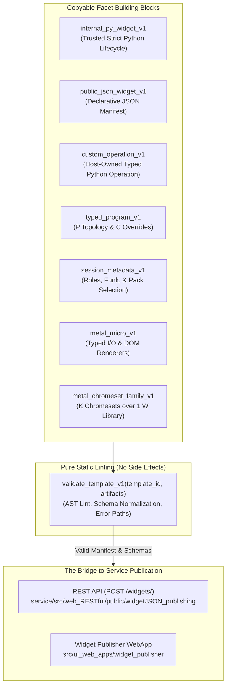

# Public Authoring Templates & Facets

The `authoring_funneling_templates` package is the copyable, versioned authoring surface for creators, creative family maintainers, and widget developers. It provides clean, decoupled building blocks ("facets") across the Thinkument computation and presentation stack, paired with a pure static validator.

---

## 1. Top-Down Philosophy and Authoring Model

Rather than forcing creators to learn complex internal kernel APIs or Python class MRO hierarchies, this package provides curated, copyable templates that separate concerns cleanly:



---

## 2. The Seven Authoring Facets

Declared in `catalog.v1.json` and implemented under `facets/`:

| Facet Identifier | Role & Scope | Key Files |
| :--- | :--- | :--- |
| `internal_py_widget_v1` | **Trusted Python Widget**: Strict lifecycle class implementing `_on_mount`, `_on_fill`, typed ports, and Analytica signal catchers. | `facets/internal_py_widget/template_internal_py_widget.py` |
| `public_json_widget_v1` | **Public Declarative JSON Widget**: Pure JSON manifest executing transitions over approved transforms and admitted micros. | `facets/public_json_widget/manifest.json` |
| `custom_operation_v1` | **Custom Host Python Operation**: Typed, versioned operation registered onto `FunctionVocab` for JSONfnchainTM without polluting Vendor Hub. | `facets/custom_operation/custom_operation.py`<br/>`facets/custom_operation/widget.json` |
| `typed_program_v1` | **Typed Program & Overrides**: `typed_think_program_v1` program topology ($P$) with D-expressions, symbols, and parameters ($C$). | `facets/typed_program/P.json`<br/>`facets/typed_program/C.json` |
| `session_metadata_v1` | **Session Metadata**: Declarative system configuration, role modulation matrices, chain-reaction Funk policies, and app-pack selection. | `facets/session_metadata/system.json`<br/>`facets/session_metadata/roles.json`<br/>`facets/session_metadata/app_pack.json` |
| `metal_micro_v1` | **Typed Micro Control**: Backend definition (schema, coercion, validation) mapped to a trusted browser DOM renderer. | `facets/metal_micro/template_micro_definition.py`<br/>`facets/metal_micro/template_micro_renderer.js` |
| `metal_chromeset_family_v1`| **$K$-Family Chromesets**: Multi-pack publication where $K$ browser chromes share a single $W$ widget library ($K + W$). | `facets/metal_chromeset_family/chromesets.json`<br/>`facets/metal_chromeset_family/index.js` |

---

## 3. Pure Preparation vs. Explicit Registration

In Layer C (Pure JSON Declarations), widget generation is strictly bifurcated:

```python
from authoring_funneling import (
    prepare_json_widget_v1,
    register_prepared_json_widget_v1,
)

# 1. Pure Preparation (Zero Kernel Side-Effects)
# Validates manifest syntax, compiles JSON flows, normalizes port schemas,
# and generates deterministic SHA-256 fingerprint.
artifact = prepare_json_widget_v1(manifest_dict)

print(artifact.widget_id)    # e.g. "creative.my_widget"
print(artifact.fingerprint)  # SHA-256 hash of canonical normalized manifest
print(artifact.widget_class) # Dynamically compiled Python class

# 2. Explicit Process Registration
# Registers the prepared class into the process-local kernel memory.
# Thread-safe and idempotent: registering matching content returns the class;
# registering conflicting content under the same ID raises ValueError.
registered_class = register_prepared_json_widget_v1(artifact)
```

---

## 4. Static Validation (`validation.py`)

Authors can statically validate complete compositions without kernel mutation or network access:

```python
from authoring_funneling_templates import validate_template_v1

# Validate curated catalog example
result = validate_template_v1("metal_typed_json_widget_v1")
assert result["ok"] is True

# Validate user-edited overrides
result = validate_template_v1("metal_typed_json_widget_v1", {
    "widget": my_edited_manifest_dict,
    "P": my_edited_program_dict,
})

if not result["ok"]:
    for err in result["errors"]:
        print(f"Error in {err['artifact']} at path {err['path']}: {err['message']}")
```

### Validation Invariants
* **AST & Syntax Linting**: Python facets are parsed via Python's `ast.parse` to ensure syntax validity.
* **Schema Normalization**: Port schemas (`str`, `int`, `float`, `bool`, `map`, `list`, records) are verified using `bindings2bindingsTM`.
* **Admitted Micros**: Widget shells (`reexplode`) are checked against the admitted micro catalogue (`validate_shell`).
* **Zero Registration**: The validator **never** calls `pull_thinkwidget_class_into_kernel_v1` or alters process state.

---

## 5. Adding Custom Python Operations (`custom_operation_v1`)

When a JSON widget requires domain computation not available in the built-in transforms or Vendor Hub, authors use the `custom_operation_v1` pattern:

```python
# facets/custom_operation/custom_operation.py
from bindings2bindingsTM import Dict, Str
from authoring_funneling.b_typed_JSON_widget_declaration.vocab_hub import (
    create_default_vocab,
)

def create_vocab():
    vocab = create_default_vocab()
    vocab.register(
        name="example.text.add_period",
        inputs=Dict({"text": Str}),
        output=Dict({"text": Str}),
        fn=lambda args, context: {"text": args["text"].rstrip(".") + "."},
        version="1",
    )
    return vocab
```

1. The custom function is typed using `bindings2bindingsTM` and registered with an explicit version string (`"1"`).
2. The JSON manifest names the function in its transition steps: `{"id": "step1", "fn": "example.text.add_period", "args": {"text": "$answer.text"}}`.
3. The custom function executes as trusted host Python in the Celery worker; the JSON definition remains declarative and sandboxed.

---

## 6. The Bridge to Service Publication

Once artifacts are authored and validated using this package:
1. **Via UI WebApp**: Creators open the [Widget Publisher WebApp](../../src/ui_web_apps/widget_publisher/README.md), paste the manifest into the `ManifestEditorChamber`, and click "Save Draft".
2. **Via REST API**: External CI/CD or scripts submit the manifest directly to the service:
   ```bash
   curl -X POST https://api.thinkument.com/widgets/ \
     -H "Authorization: Bearer <TOKEN>" \
     -H "Idempotency-Key: <UUID>" \
     -H "Content-Type: application/json" \
     -d '{"manifest": { ... }}'
   ```
3. **Service Governance**: The service application (`public.widgetJSON_publishing`) persists the version, evaluates factual labels, and gates execution through the Markovian Artery Net.

For the complete service publishing architecture, see [3_widgetJSON_publishing.MD](../../about/scaling_app_packs/3_widgetJSON_publishing.MD).


